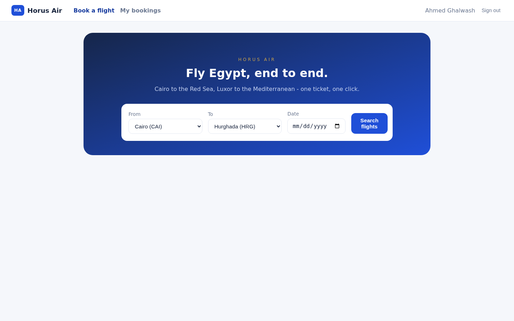
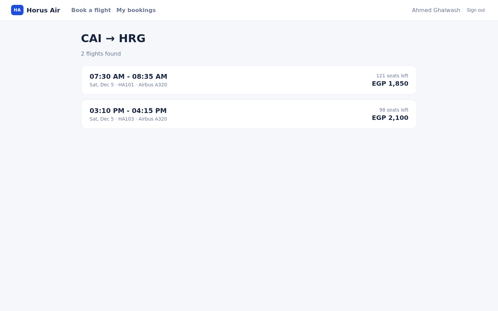
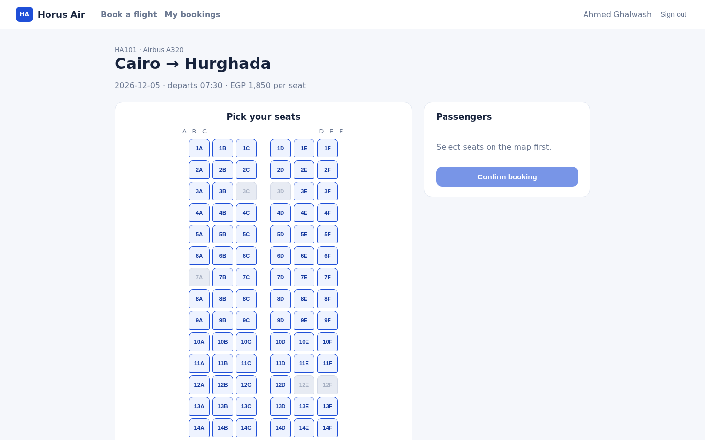
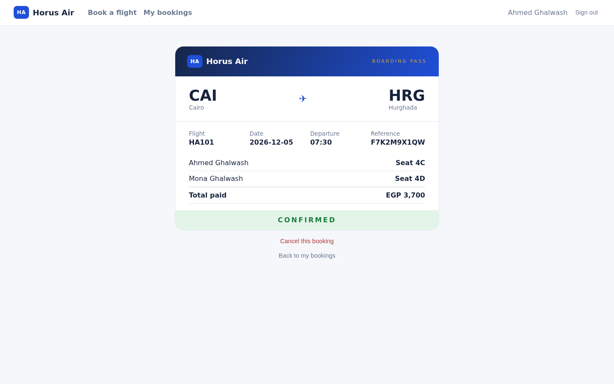

# Horus Air - Airline Ticket Booking

An airline ticket booking website for domestic flights across Egypt.

Full-stack concept application: a **React 18** single-page client, a **PHP 8 REST API**
(framework-free, PDO with prepared statements) and a **MySQL** database.

## Features

- Flight search by route and date across a domestic network
- Interactive seat map generated per flight (6 seats x 28 rows)
- Transactional booking: every seat is claimed with a guarded UPDATE so a seat can never be sold twice
- Boarding-pass style ticket with passenger names, seats and a unique reference
- Cancellation releases the seats back to the map, refused after departure

## Tech stack

| Layer | Tech |
| --- | --- |
| Front end | React 18, Vite, React Router |
| Back end | PHP 8.1+, PDO (native prepared statements), PHP sessions |
| Database | MySQL 8 (InnoDB, foreign keys, transactions) |

## Screenshots

| Screen | Preview |
| --- | --- |
| Flight search |  |
| Search results |  |
| Seat map and passenger form |  |
| Boarding pass |  |

## Source code

The full source code for this project - the React client, the PHP REST API, and the
database schema with seed data - is kept in a **private repository**.

It is available on request: reach out through my
[GitHub profile](https://github.com/ahmed-ghalwash) and I will be happy to share it.
